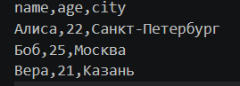
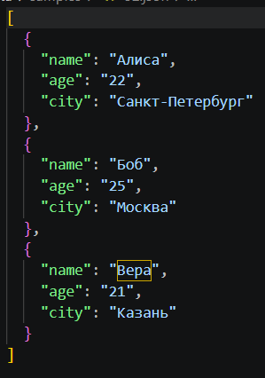
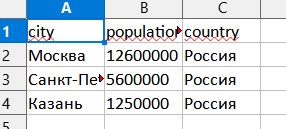

# pythonlabs
# Лабораторная работа 5

# Задание A — JSON ↔ CSV

функция j конвертирует JSON в CSV, проверяет, что корневой объект является непустым списком словарей, и записывает данные в CSV

функция c конвертирует CSV в JSON, проверяет наличие заголовка и строк с данными, а затем сохраняет результат с отступами

функция p выводит содержимое файла в консоль с нумерацией строк для наглядности

# Задание B — CSV → XLSX

функция x конвертирует CSV в XLSX, проверяет файл на наличие заголовка и данных, создает Excel-книгу и записывает в нее строки

функция также выводит в терминал отчет о создании файла и количестве перенесенных строк

