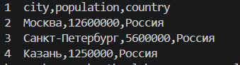

# pythonlabs
# Лабораторная работа 6

# Задание A — CLI-утилита для текста (cli_text)

Подкоманда stats выполняет частотный анализ слов в тексте, выводя топ-N самых частых слов.

Подкоманда cat выводит содержимое текстового файла построчно. Поддерживает флаг -n для добавления нумерации строк.

# Задание B — CLI-конвертер (cli_convert)

Подкоманда json2csv конвертирует JSON-файл в CSV, используя функцию j из ЛР5.

Подкоманда csv2json конвертирует CSV-файл в JSON, используя функцию c из ЛР5.

Подкоманда csv2xlsx конвертирует CSV в Excel-файл (XLSX), проверяет наличие заголовка и сохраняет данные.

ssss