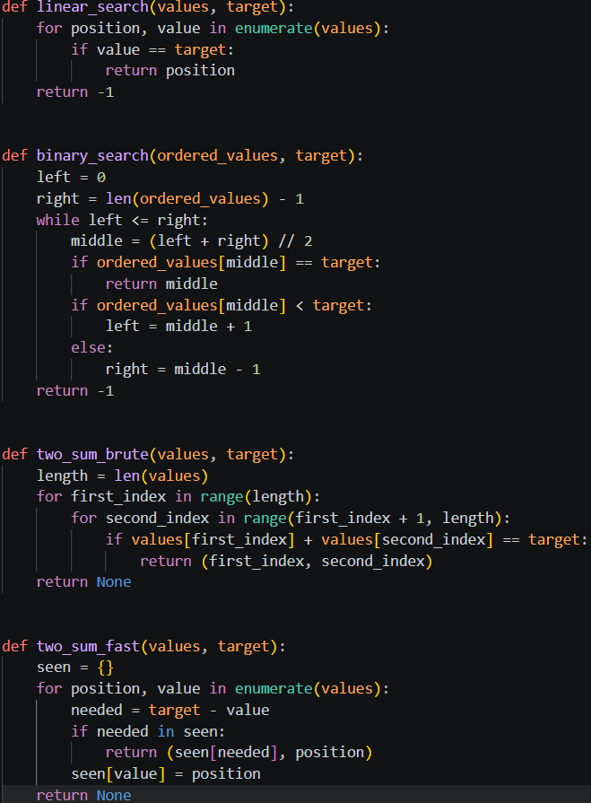
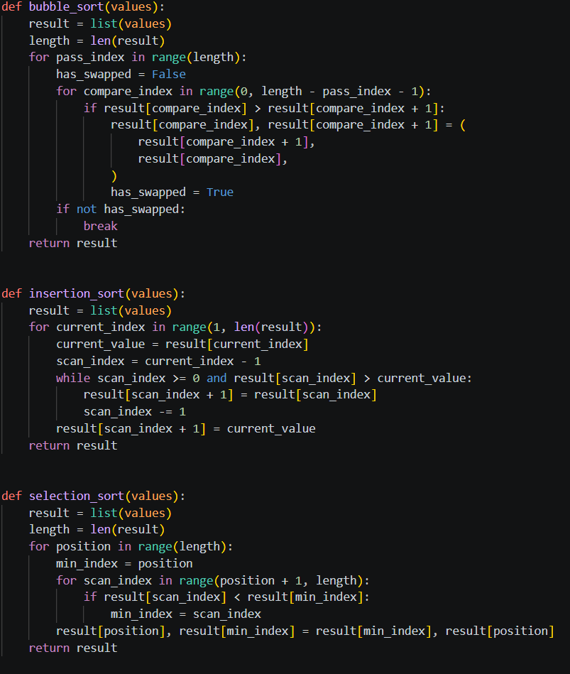
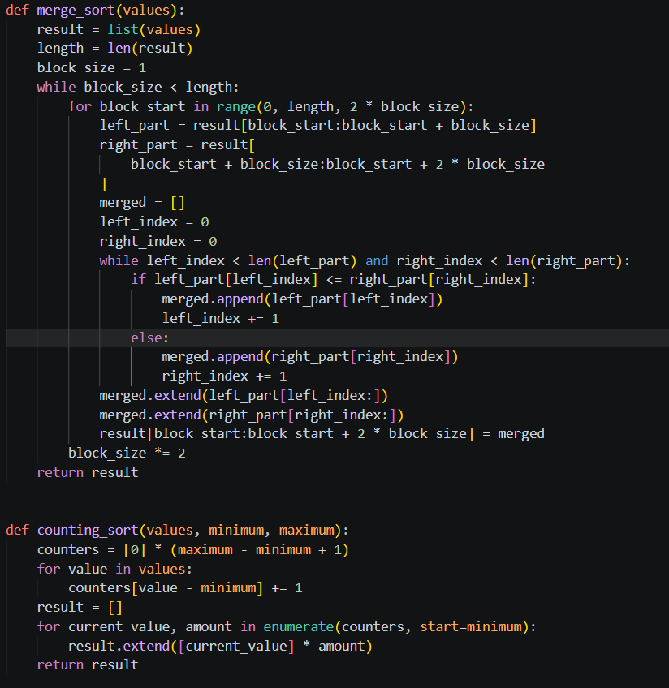
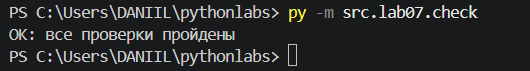
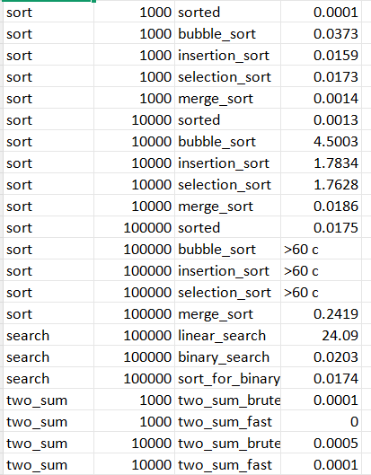

# pythonlabs
# Лабораторная работа 7

# Задание A — Поиск (search.py)

Реализованы алгоритмы линейного и бинарного поиска. Также реализован алгоритм Two Sum в двух вариантах: полный перебор (brute) и оптимизированный с помощью хеш-таблицы (fast).

# Задание B — Сортировка (sorting.py)

Реализованы классические алгоритмы сортировки: пузырьком, вставками и выбором. В качестве дополнительного задания реализована итеративная сортировка слиянием (merge_sort) и сортировка подсчетом (counting_sort).

# Задание C — Проверка корректности (check.py)

Скрипт тестирует все написанные алгоритмы на случайных данных. Сравнивает результаты со встроенными функциями Python (sorted, list.index) и проверяет, что исходные списки не изменяются.

# Задание D — Бенчмарк (bench.py)

Утилита для замера времени работы алгоритмов с помощью модуля timeit. Результаты сохраняются в формате CSV (data/lab07/bench.csv).

ss

